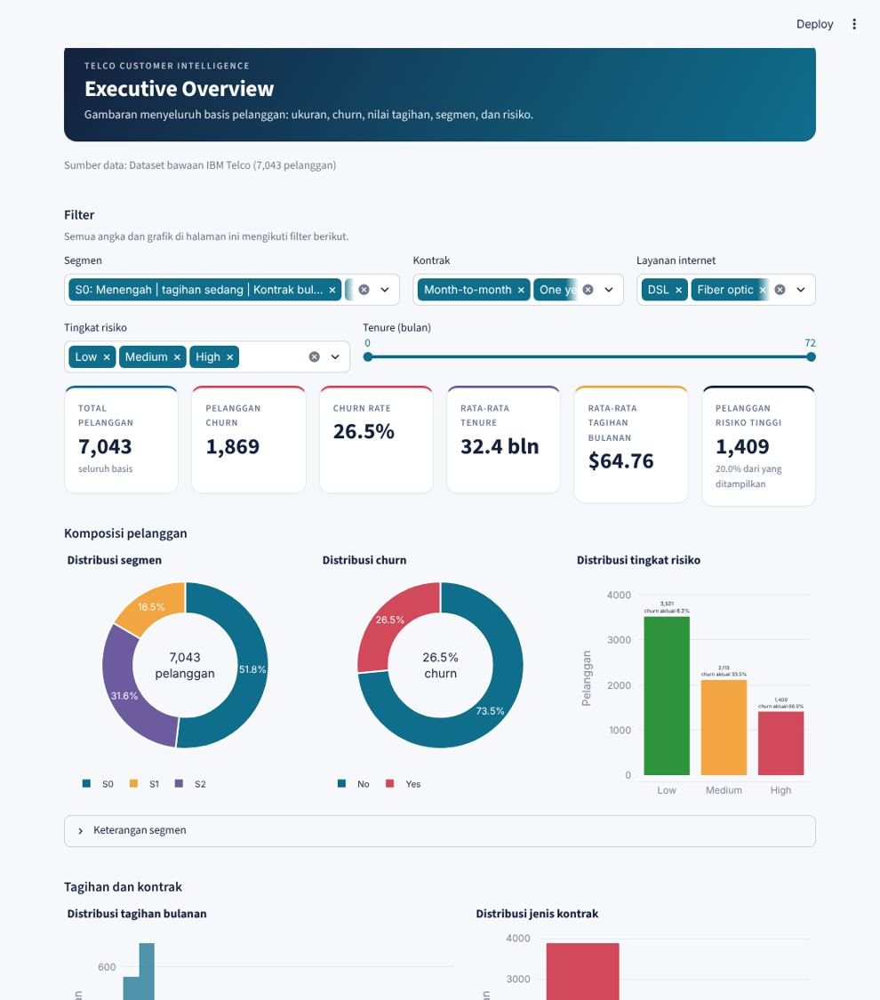
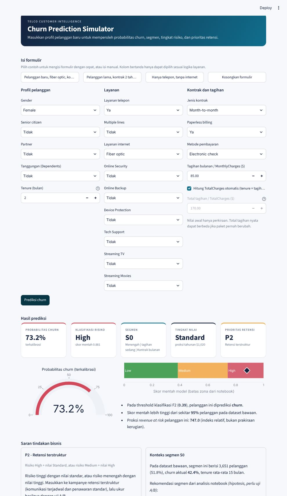

# TELCO CUSTOMER INTELLIGENCE

*An Integrated Customer Analytics, Segmentation & Churn Prediction Platform*

Aplikasi Streamlit multi-halaman yang mengubah analisis pelanggan telekomunikasi (dikerjakan di Google Colab) menjadi platform interaktif: eksplorasi pelanggan, segmentasi, analisis churn, prediksi churn untuk pelanggan baru, prioritas retensi, dan dokumentasi metodologi.

> **Aplikasi online:** *(tambahkan URL Streamlit Community Cloud di sini setelah deploy)*

Aplikasi ini **memuat** model hasil notebook dan **tidak melatih ulang** apa pun. Semua angka berasal dari notebook atau dihitung langsung dari data.

## Ringkasan hasil

| Komponen | Ringkasan |
|---|---|
| Data | IBM Telco Customer Churn: 7.043 pelanggan, 21 kolom, churn 26,54% |
| Segmentasi | K-Means, k = 3 (Silhouette 0,4029) |
| Model churn | XGBoost. CV PR-AUC 0,668; test ROC-AUC 0,847 dan PR-AUC 0,667 |
| Threshold | 0,39 (kriteria F2), probabilitas dikalibrasi dengan regresi isotonik |
| Pengujian | 223 pemeriksaan otomatis dalam 6 suite uji |

Model-model di atas sebanding dengan beberapa alternatif secara statistik (6 dari 7 model berada dalam 1 SD pada PR-AUC cross-validation). Lihat halaman *Methodology* untuk rinciannya, termasuk keterbatasan.

## Halaman aplikasi

| Halaman | Isi |
|---|---|
| **1. Executive Overview** | KPI basis pelanggan, distribusi segmen, churn, risiko, tagihan, dan kontrak dengan filter interaktif |
| **2. Customer Segmentation** | Ukuran dan profil tiap segmen, perbandingan metrik, adopsi layanan, interpretasi per segmen |
| **3. Customer Explorer** | Cari dan saring pelanggan, detail pelanggan individual, unduh CSV |
| **4. Churn Intelligence** | Churn menurut demografi, tenure, kontrak, pembayaran, layanan; hasil uji statistik dan faktor risiko |
| **5. Churn Prediction** | Simulator untuk pelanggan baru: probabilitas, risiko, segmen, nilai, prioritas, dan saran tindakan |
| **6. Retention Strategy** | Prioritas P1-P4, revenue at risk (proksi), rekomendasi per segmen, daftar prioritisasi yang bisa diunduh |
| **7. Methodology** | Data, segmentasi, pemilihan model, evaluasi (ROC/PR/confusion matrix), interpretabilitas, keterbatasan |




Tangkapan layar halaman lain ada di folder [`docs/screenshots`](docs/screenshots).

## Sumber data dan unggahan CSV

- **Bawaan:** dataset dibaca dari `data/WA_Fn-UseC_-Telco-Customer-Churn.csv` (path relatif), sehingga pengguna tidak perlu mengunggah apa pun. Jika file itu hilang, aplikasi mencoba salinan resmi IBM di GitHub (isinya identik) sebagai cadangan.
- **Unggahan opsional:** pengguna dapat mengunggah CSV sendiri di sidebar. File divalidasi (kolom wajib, nilai kategori, angka, duplikat ID, logika layanan, maksimal 20.000 baris) **sebelum** masuk ke model. Kolom `Churn` bersifat opsional.
- Kode aplikasi tidak menyimpan file unggahan ke disk atau database; data hanya ada di memori server selama sesi.

Kolom wajib: `gender, SeniorCitizen, Partner, Dependents, tenure, PhoneService, MultipleLines, InternetService, OnlineSecurity, OnlineBackup, DeviceProtection, TechSupport, StreamingTV, StreamingMovies, Contract, PaperlessBilling, PaymentMethod, MonthlyCharges, TotalCharges`.

## Dua jenis skor (penting)

- **Dataset bawaan** memakai skor **out-of-fold** dari notebook (setiap pelanggan diprediksi oleh model yang tidak pernah melihat dirinya), sehingga angka dashboard identik dengan laporan analisis.
- **Simulator dan CSV unggahan** memakai **model final** yang dilatih pada seluruh data. Jika Anda memasukkan pelanggan yang ada di dataset training, skornya bisa sedikit berbeda dari skor out-of-fold.

## Struktur repository

```text
.
├── app.py                         # titik masuk: navigasi, tema, sidebar, pilihan sumber data
├── requirements.txt               # versi dipatok (sesuai versi saat model dilatih)
├── pages/                         # 7 halaman aplikasi
├── utils/                         # config, data_loader, model_loader, analytics, evaluation,
│                                  # simulator, business, visualizations, ui
├── models/                        # bundle model (+ cadangan portabel), customer_features.py
├── data/                          # dataset mentah dan tabel hasil analisis
├── metadata/                      # skema fitur, kamus data, info sesi pelatihan
├── reports/                       # metrik, segmentasi, interpretabilitas, bisnis, gambar
├── notebooks/                     # notebook analisis (Google Colab) sebagai sumber hasil
├── tests/                         # 6 suite uji otomatis + run_all.py
├── tools/                         # skrip ekstraksi output notebook + sel Colab ekspor prediksi test
└── docs/                          # panduan deployment dan tangkapan layar
```

Aplikasi hanya memakai `models/`, `data/`, `metadata/`, dan `reports/`. Notebook di `notebooks/` adalah sumber analisisnya dan tidak dibaca oleh aplikasi.

## Menjalankan secara lokal

Butuh **Python 3.12** (versi yang diuji).

Windows:

```bat
py -3.12 -m venv .venv
.venv\Scripts\activate
python -m pip install --upgrade pip
pip install -r requirements.txt
streamlit run app.py
```

macOS / Linux:

```bash
python3.12 -m venv .venv
source .venv/bin/activate
pip install -r requirements.txt
streamlit run app.py
```

Aplikasi terbuka di `http://localhost:8501`.

## Pengujian

```bash
python -m tests.run_all
```

Hasil yang diharapkan: `Total: 223 pemeriksaan lulus, 0 gagal.` Suite uji mencakup loader data dan model, semua halaman (data bawaan dan unggahan), validasi dan penolakan CSV buruk, artefak hilang atau rusak, uji properti prediksi pada 4.000 pelanggan acak, portabilitas (tanpa path absolut, tanpa kredensial, dependensi sesuai `requirements.txt`), dan kinerja.

## Deployment (GitHub + Streamlit Community Cloud)

Ringkasnya: dorong repo ke GitHub, buka [share.streamlit.io](https://share.streamlit.io), pilih repo ini, **main file path `app.py`**, dan di *Advanced settings* pilih **Python 3.12**. Langkah rinci dan pemecahan masalah ada di [`docs/DEPLOYMENT_GUIDE.md`](docs/DEPLOYMENT_GUIDE.md).

## Memperbarui model atau data

1. Jalankan ulang notebook di Colab dan ekspor artefak.
2. Jalankan sel di [`tools/colab_export_test_predictions.py`](tools/colab_export_test_predictions.py) untuk mengekspor prediksi test set (grafik ROC/PR interaktif).
3. Ganti isi `models/`, `metadata/`, `data/processed/`, dan `reports/` dengan hasil ekspor baru.
4. Pastikan `scikit-learn` dan `xgboost` di `requirements.txt` sama dengan `metadata/session_info.json`.
5. Jika ada hasil yang hanya berupa teks di notebook, ekstrak ulang dengan `tools/extract_notebook_outputs.py`.
6. Jalankan `python -m tests.run_all`, lalu `git push`.

## Keterbatasan

- Data berupa satu snapshot tanpa tanggal; analisis survival bergantung pada asumsi sensor.
- Tidak ada data biaya atau margin: `annual_value_proxy` (tagihan bulanan × 12) hanyalah proksi, dan *revenue at risk* adalah **indeks prioritisasi relatif**, bukan prakiraan kerugian.
- Semua temuan (uji statistik, odds ratio, importance, simulasi skenario) adalah **asosiasi**, bukan sebab-akibat. Efek intervensi retensi hanya dapat diukur dengan uji A/B.
- Tingkat risiko memakai kuantil skor (High = 20% teratas), sehingga proporsinya pada dataset bawaan selalu sekitar 20%.
- Panduan tindakan per prioritas adalah aturan, dan rekomendasi per segmen adalah hipotesis dari notebook.

## Sumber data dan atribusi

Dataset *Telco Customer Churn* adalah dataset contoh dari IBM yang tersedia luas untuk keperluan belajar. Mohon periksa dan ikuti ketentuan penggunaan dari sumber aslinya jika Anda akan menggunakannya di luar keperluan pembelajaran.
